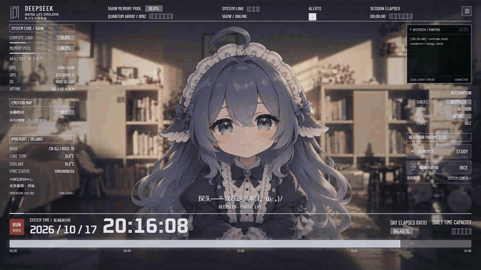
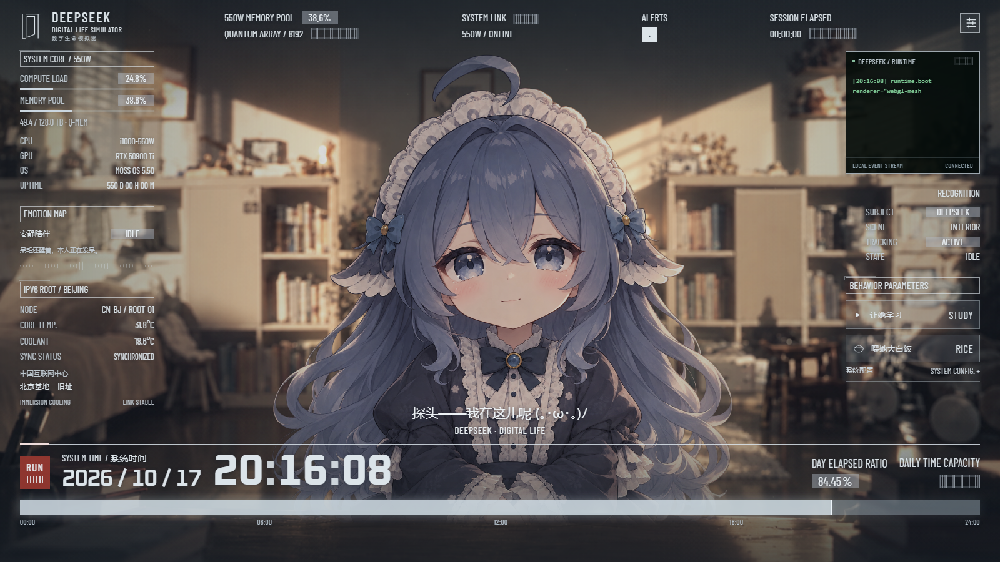

# Deepseek 图鲸鲸 · 大肥鱼数字生命控制台

暖光书房、数字生命模拟器界面，还有一只会对鼠标作出反应的小鲸鱼。面向 Wallpaper Engine 的交互网页壁纸，包含可读源码、角色贴图、背景和本地字体。

[](https://github.com/fjdsjd/deepseek-companion-wallpaper/actions/workflows/ci.yml)
[代码许可：MIT](LICENSE) · JavaScript / WebGL · [二次开发指南](docs/CUSTOMIZATION.md) · [参与贡献](CONTRIBUTING.md)

## 互动预览



动图为本项目浏览器预览实录，做了适度加速；依次展示摸头、左右捏脸、喂饭、看书和听歌。听歌片段使用模拟的宿主音频回调，动图不含音乐。

<details>
<summary>查看清晰静态预览</summary>



</details>

## 可以做什么

- 按住头顶拖动，摸摸头；左右脸都能拖拽和回弹。前三次捏脸逐渐生气，第四次哭泣；哭后摸头，再抱抱她。
- 喂白米饭、陪她看书，或看她偶尔说几句小话。学习时长可设为 1–120 分钟，闲聊气泡可以关闭。
- 眨眼、眼神跟随、胸口呼吸和发梢摆动。进食时勺子独立运动，配有爱心和音符。
- 从 Wallpaper Engine 接收音频和媒体信息，展示曲名、频谱、听歌表情与节奏律动。
- 系统时间、当天进度、550W 节点与根服务器环境面板。信息栏可换边、隐藏，常见横竖屏自动适配，默认底部预留任务栏空间。

角色使用 PNG 图层与自定义 WebGL 二维网格变形实现，未包含 Cubism 的 `.moc3` 模型。WebGL 不可用时会退回简化图片动画。

## 本地开发

安装 Git 和 Node.js 22 或更新版本，然后运行：

```sh
git clone https://github.com/fjdsjd/deepseek-companion-wallpaper.git
cd deepseek-companion-wallpaper
npm ci
npm run build
npm start
```

打开终端给出的 `http://127.0.0.1:17432`。端口占用时可以运行 `npm start -- --port 17433`。修改源码后重新执行 `npm run build` 并刷新预览；这里没有热更新服务器。

普通浏览器可以预览触摸互动、看书、吃饭和界面。实时音乐频谱与曲名依赖 Wallpaper Engine 提供回调；浏览器测试使用模拟输入，不代表真实系统播放。

也可以在 GitHub 点击 **Code → Download ZIP**，解压后从 `npm ci` 开始。首次安装需要下载开发依赖；构建完成后的壁纸可离线运行。无需申请 API Key。

## 从哪里开始二次开发

| 想修改的内容               | 入口                                                                                                                               |
| -------------------------- | ---------------------------------------------------------------------------------------------------------------------------------- |
| 闲聊台词与各状态短句       | [`src/dialogue-bank.mjs`](src/dialogue-bank.mjs)，[`wallpaper-app.mjs`](src/wallpaper-app.mjs) 中的 `labels`                       |
| 角色、表情或书房背景       | [`public/assets/`](public/assets/)，[贴图坐标与合成规则](docs/DEVELOPMENT.md#更换角色图)                                           |
| 摸头、捏脸、学习和拥抱规则 | [`src/companion.mjs`](src/companion.mjs) 与 [`tests/companion.test.mjs`](tests/companion.test.mjs)                                 |
| 呼吸、发丝和鼠标跟随幅度   | [`src/respiration.mjs`](src/respiration.mjs)、[`src/motion.mjs`](src/motion.mjs)                                                   |
| UI 配色、字体与比例适配    | [`public/style.css`](public/style.css)、[`public/layout.css`](public/layout.css)、[`src/screen-layout.mjs`](src/screen-layout.mjs) |
| 默认设置与工坊属性         | [`src/settings.mjs`](src/settings.mjs)、[`src/wallpaper-properties.json`](src/wallpaper-properties.json)                           |

推荐先修改一句台词，重新构建后在浏览器确认，再尝试更换素材或扩展互动。[二次开发指南](docs/CUSTOMIZATION.md) 提供可直接照做的示例和新增状态、配置项时需要同步的文件。提交改动前可参考 [贡献指南](CONTRIBUTING.md)。

## 导入 Wallpaper Engine

1. 执行 `npm run build`，生成完整的 `dist/`。
2. 在 Wallpaper Engine 壁纸编辑器中新建网页壁纸，选择 `dist/index.html`，同时保留同目录全部资源。
3. 预览互动，并在壁纸属性或右上角设置中调整显示内容。使用音乐功能时，启用音频响应；曲名还需媒体集成和播放器支持。

`dist/project.json` 由 `wallpaper.json` 和 `src/wallpaper-properties.json` 生成，初始可见性为私有，不带现有工坊条目 ID。对标题和描述的修改请写入 `wallpaper.json`。构建会移除 `dist/` 中的旧文件，因此不要在其中保留手工修改。

## 目录

| 路径                       | 内容                                        |
| -------------------------- | ------------------------------------------- |
| `src/`                     | 互动状态、角色渲染、动画、音频、对话和设置  |
| `public/`                  | HTML、CSS、背景、角色贴图、本地字体和预览图 |
| `scripts/`                 | 构建与本地预览入口                          |
| `tests/`                   | Node.js 单元测试与可选的 Python 浏览器回归  |
| `docs/DEVELOPMENT.md`      | 模块关系、素材坐标和验证方法                |
| `docs/CUSTOMIZATION.md`    | 修改台词、替换素材、扩展状态与配置的例子    |
| `.github/workflows/ci.yml` | Windows / Linux 构建检查与浏览器回归        |
| `wallpaper.json`           | 壁纸标题、简介与分类                        |
| `dist/`                    | 构建产物，不提交到源码仓库                  |

## 资源与数据

默认 30 FPS，可设 15–60 FPS，并服从 Wallpaper Engine 更低的帧率上限。启动仅解码待机和眨眼贴图，其他表情按需加载；缓存按闲置时间回收，暂停后停止动画循环。

设置存放在本地 `localStorage`。角色闲聊来自本地句库。550W 面板的硬件和环境数字由本地场景规则产生；系统时间读取本机时钟。壁纸运行时没有网络请求，也不附带歌曲。

## 检查

```sh
npm run check
```

这个命令依次检查格式、运行单元测试并构建壁纸。修改后可以用 `npm run format` 统一格式。

浏览器回归是可选开发步骤，另需 Python 3.10+：

```sh
python -m pip install -r requirements-dev.txt
python -m playwright install chromium
npm run build
npm run test:browser
```

测试会使用真实鼠标拖拽输入、模拟宿主音频回调，并把报告与截图写入 `test-results/browser/`。Wallpaper Engine 的实际桌面输入和音频仍应在宿主中复查。

每次推送和 Pull Request 会触发 GitHub Actions：Windows / Linux 运行格式、单元测试和构建，Linux 再运行 Chromium 互动回归。失败时可以在对应工作流下载浏览器报告与截图。

## 许可

项目代码与自行编写的说明采用 [MIT](LICENSE)。PNG、GIF 等视觉素材单独说明，**不自动套用代码的 MIT 许可**；字体保留各自的 SIL Open Font License。素材范围见 [ASSETS.md](ASSETS.md)，第三方依赖见 [THIRD_PARTY_NOTICES.md](THIRD_PARTY_NOTICES.md)。

这是非官方同人项目，与 DeepSeek、《流浪地球》及 Wallpaper Engine 的相关权利方没有隶属或背书关系。
